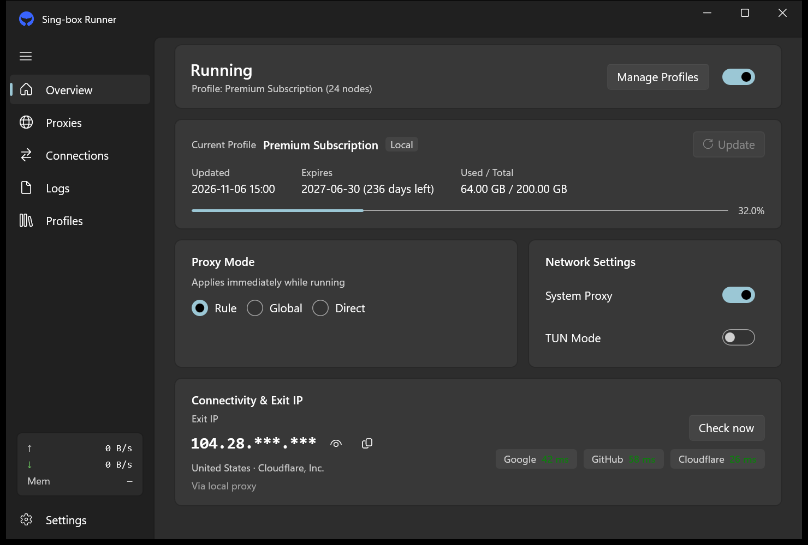
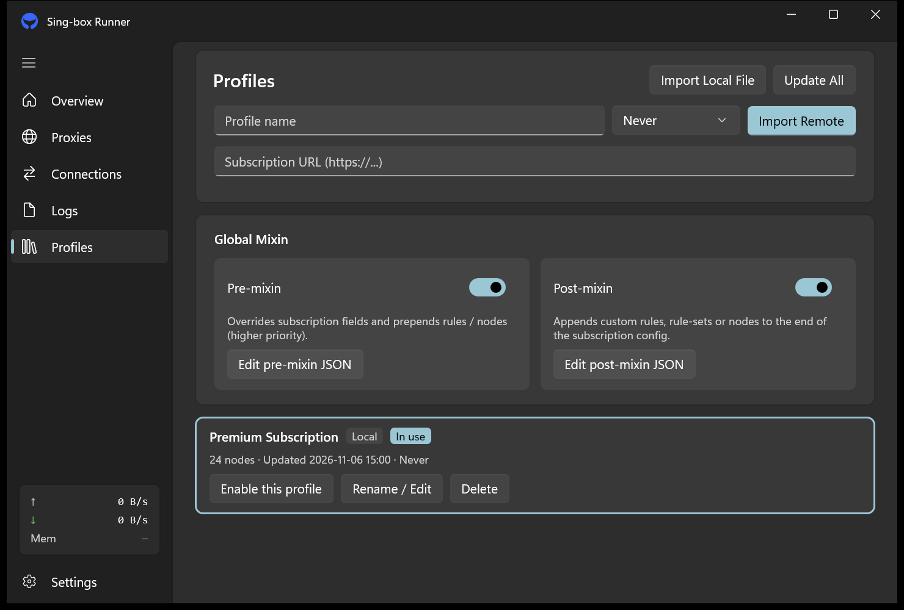

<div align="center">


# SingBoxWinUI

**基于 Windows 11 Fluent Design 与云母（Mica）材质的原生轻量级 sing-box 客户端**


<br />

[](https://github.com/Hoomarck/SingBoxWinUI/releases/latest)
[](#-下载与安装)
[](#)
[](#-声明)

<br />

<a href="https://github.com/Hoomarck/SingBoxWinUI/releases/latest">
  
</a>

**[📥 下载最新版本 (Releases)](https://github.com/Hoomarck/SingBoxWinUI/releases/latest)**

</div>

---

## 🖼 软件界面预览

<div align="center">

<br />
<sub><b>概览</b>　一键启停 · 流量与到期 · 代理模式 · 出口 IP 与连通性检测</sub>
</div>

<table align="center">
  <tr valign="top">
    <td align="center" width="50%">
      
      <br />
      <sub><b>订阅与 Mixin</b>　本地导入 · 远程订阅 · 前后置 Mixin 编辑器</sub>
    </td>


---

## ✨ 功能亮点

- 🎨 **原生 Fluent 外观，中英实时切换**　云母材质 + WinUI 3 原生控件，跟随系统深浅色；中英文切换即时生效，无需重启。
- 🌐 **开箱即用的连通性检测**　自动识别出口 IP 与归属地（可一键打码），同时探测 Google / GitHub / Cloudflare 延迟，网络状况一眼看清。
- 🧩 **智能 Mixin，换订阅不用改配置**　前置 / 后置 Mixin 自动剥离节点，只保留你自己的规则；订阅定时更新，规则集自动补齐与更新。
- ⚡ **内置内核一键热更新**　在设置里检查新版本，下载、校验、替换全自动，失败自动回滚，不用手动折腾文件。
- 🪶 **极致后台轻量模式**　隐藏到托盘一段时间后自动释放内存，常驻后台也几乎感觉不到它。
- 💾 **本地与 WebDAV 备份恢复**　配置可打包备份到本地或坚果云 WebDAV，换机器一键还原。

---

## 📦 下载与安装

> 💡 **新手 / 首次安装（强烈推荐）**
> 下载 **`SingBoxWinUI-Setup-v1.0.0-win-x64-with-core.exe`** —— 内置 `sing-box` 核心与全套规则集，**双击安装即可使用**，安装时可勾选「开机自启」和「桌面快捷方式」。

| 版本 | 适合谁 | 安装包（推荐） | 免安装便携包 |
| :--- | :--- | :--- | :--- |
| **with-core**<br>带核心完整版 | 第一次使用、想要装完即用 | `SingBoxWinUI-Setup-v1.0.0-win-x64-with-core.exe` | `SingBoxWinUI-v1.0.0-win-x64-with-core.7z` |
| **no-core**<br>不带核心精简版 | 老用户升级、已有内核或只想更新界面 | `SingBoxWinUI-Setup-v1.0.0-win-x64-no-core.exe` | `SingBoxWinUI-v1.0.0-win-x64-no-core.7z` |

- **覆盖安装很安全**：`no-core` 不会动你已有的 `Core\sing-box.exe`；任何版本升级都不会覆盖你的订阅和配置。
- **喜欢免安装**：下 `.7z` 便携包，解压到任意目录，目录随便移动也不会出问题。
- 每个文件都附带 `.sha256` 校验值，下载后可在 [Releases](https://github.com/Hoomarck/SingBoxWinUI/releases/latest) 页面核对。

### 命令行安装（WinGet）

已提交 WinGet 官方仓库，审核通过后可用一条命令安装：

```powershell
winget install doubinanberwan.SingBoxWinUI
```

---

## 🚀 三步快速上手

1. **安装并运行**　双击安装包完成安装（建议保留「创建桌面快捷方式」），然后打开 **SingBoxWinUI**。
2. **导入订阅**　进入「订阅」页，把订阅链接粘进输入框点「导入远程」，或点「导入本地文件」选择本地的配置 / 订阅文件。
3. **打开开关**　回到「概览」页，打开右上角的开关；需要全局接管就再打开「系统代理」或「TUN 模式」。

> TUN 模式需要管理员权限，开启时程序会自动请求一次授权。

---

## 📄 声明

本项目是 [sing-box](https://github.com/SagerNet/sing-box) 的**第三方图形前端**，与 sing-box / SagerNet 官方无隶属关系。

本仓库**不提供、不内置、不推荐**任何代理节点、订阅服务或配置数据 —— 请使用你自己的订阅。使用者需自行遵守所在国家或地区的法律法规。
